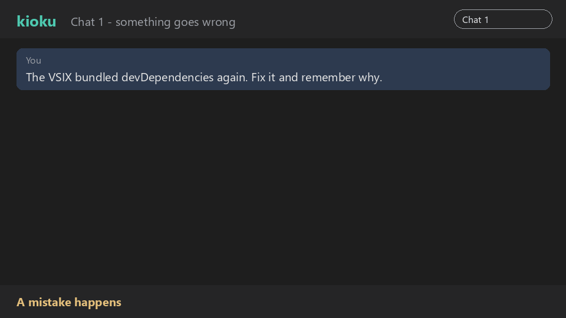

# kioku

> kioku is a fork of [claude-mem](https://github.com/thedotmack/claude-mem) by Alex Newman, licensed under Apache-2.0. Files were modified from the upstream. The original README is kept at [docs/upstream-README.md](docs/upstream-README.md). kioku is not affiliated with or endorsed by the claude-mem project or cmem.ai.

**Stop your AI agent from making the same mistake twice.**

**kioku** ("memory" in Japanese) gives GitHub Copilot Chat a fast, persistent long-term memory directly on your PC. Instead of dumping noisy chat logs, it records **what happened**, **why it succeeded or failed**, and **the exact lesson to apply next time**, so any new chat session can recall and reuse hard-won project knowledge.

- **One VSIX, zero setup:** No Node.js, Python, Docker, Chroma server, or external vector database is required.
- **Native Rust MCP option:** A staged Rust MCP core uses the existing SQLite database directly for lower-overhead reads and search; the bundled Bun MCP path remains the default.
- **Hybrid semantic + keyword search:** Local multilingual embeddings and SQLite FTS5 are combined with reciprocal rank fusion for both exact identifiers and natural-language questions.
- **100% local memory:** Search and extractive summaries use no AI credits and send no memory data to external servers.
- **Cross-platform:** Windows, macOS, and Linux.



*Scripted illustration of the kioku tool calls.*

---

## Try It in 60 Seconds

1. Install **`ShunsukeF.kioku-search`** from the VS Code Marketplace and start **`kioku (local)`** in Copilot Chat's MCP tool list.
2. Tell Copilot in any chat:

   ```text
   Save a lesson with kioku save_memory:
   outcome="failure"
   cause="Forgot --no-dependencies when packaging a VSIX"
   lesson="Always pass --no-dependencies to vsce package."
   ```

3. Open a brand-new chat and ask:

   ```text
   Check kioku for lessons before I package a VSIX.
   ```

The lesson comes right back. To make Copilot search and record reusable lessons automatically across sessions, use **kioku: Inject Copilot Instructions** or add the instruction snippet from [vscode-extension/README.md](vscode-extension/README.md).

---

## Why Developers Use kioku

- **Turn trial-and-error into permanent rules:** Capture `outcome`, verified `cause`, and a reusable `lesson` so agents stop repeating environment-specific bugs, build flags, and API quirks.
- **Keep knowledge current:** Saving an intentional replacement can supersede an older memory, and duplicate guards prevent repeated entries for the same topic.
- **Hand work to the next chat:** `work_state_read` and `work_state_write` preserve active checkout context, status, and task history in local SQLite.
- **Move lessons between projects:** Export active project lessons to JSONL or Markdown and import them into another checkout with source-fingerprint duplicate protection.
- **Private and air-gap friendly:** No telemetry, cloud sync, external AI observation, or conversation harvesting. Memories stay in one local SQLite database.

---

## Key Capabilities

- **Structured lesson memory:** `save_memory` records `outcome` (`success`, `failure`, or `mixed`), `cause`, `lesson`, project, title, and replacement metadata.
- **Smart hybrid search:** SQLite FTS5 keyword candidates are fused with local multilingual embedding candidates from reciprocal rank fusion. Semantic candidates are filtered against the score distribution and exact keyword matches are retained.
- **Eight compact MCP tools:** `search`, `timeline`, `get_observations`, `save_memory`, `invalidate_memory`, `dumb_search`, `work_state_read`, and `work_state_write` keep the agent interface focused.
- **Automatic superseding:** The save path recognizes titled revisions and protects existing records with explicit duplicate and supersession behavior.
- **Local Rust MCP core:** Opt in to the host-native core for direct SQLite reads, hybrid RRF search, invalidation, and Work State support while retaining the existing worker for writes and semantic assistance.
- **Sidebar curation:** Browse up to 50 memories, search across projects and dates, edit project/cause/lesson fields, invalidate or restore records, and inspect Work State.
- **Project lessons portable:** Export active lessons to JSONL or Markdown; imports skip records already carrying the same source fingerprint.
- **Zero-credit summaries:** Generate a local extractive summary at no AI-credit cost, or explicitly opt in to a confirmed GitHub Copilot model summary.
- **One-command instruction setup:** Inject a marker-delimited kioku block into project or global Copilot instructions, copy a compatible `.mcp.json` entry, and keep the setup inside existing configuration files.

---

## Install

1. Install from the **VS Code Marketplace** (`ext install ShunsukeF.kioku-search`), or open the Extensions view, select **Install from VSIX...**, and choose the build for your platform, for example `kioku-search-win32-x64-0.7.0.vsix`.
2. Reload VS Code if prompted and open a trusted workspace folder.
3. Click the **kioku** brain icon in the Activity Bar. On first launch, database initialization may take a moment; a memory count of `0` is normal.
4. Enable **`kioku (local)`** in Copilot Chat's MCP tool list and approve tool access when prompted.

> If you previously configured a standalone `kioku` MCP entry manually, disable it to avoid duplicate tool registration. kioku never overwrites or deletes your existing configuration files.

Requires VS Code 1.102 or later. Supports Windows x64, macOS arm64/x64, and Linux x64/arm64.

---

## Usage & Workflow

### Saving & Searching Lessons

Prompt Copilot Chat naturally or explicitly:

- `Save this fix as a lesson in kioku so we do not hit this error again.`
- `Search kioku for past lessons related to SQLite migrations.`

Each reusable memory should contain:

- **`outcome`:** `success`, `failure`, or `mixed`
- **`cause`:** The verified reason for the result
- **`lesson`:** The concrete rule to apply or avoid next time
- **`project`:** The project or scope where the lesson applies

Search with concrete names or a short question. Hybrid search combines exact FTS matches with semantic candidates, while an empty result is not proof that no relevant memory exists.

Use `invalidate_memory({ id, reason, replacedBy })` for obsolete or incorrect observations. Invalidated memories remain in storage but leave search results. Set `restore: true` to make a memory searchable again.

### Agent Instructions & Handoffs

Use **kioku: Inject Copilot Instructions** to add a compact memory workflow to project or global Copilot instructions. The sidebar's Work State section reads active checkout context and can close open entries by appending `done` records without deleting history.

### Sidebar Curation

Open the **kioku** sidebar to:

- Search and filter up to 50 memories by keyword, project, or date range.
- Edit project, cause, and lesson fields for the selected memory.
- Invalidate or restore outdated records.
- Inspect Work State and connection status.
- Switch between English and Japanese with the header selector or `kioku.language`.
- Export and import project lessons.
- Generate local or Copilot-backed summaries.

---

## Summaries & Privacy

- **Local script summaries are the default:** They are extractive, consume no AI credits, and send no text outside your PC.
- **Copilot summaries require opt-in:** Switching the setting on sends nothing. Selecting a memory and choosing the Copilot summary opens an explicit confirmation and model-selection step.
- **Only selected content is sent:** The selected title, subtitle, body, and facts are included in an opt-in Copilot summary.
- **No automatic capture:** Conversation harvesting, external AI observation, cloud sync, telemetry, and automatic updates are disabled.
- **No external search services:** The bundled multilingual embedding model runs locally through ONNX Runtime.

---

## Data, Security & Existing Environments

- **Local storage:** Memories use `.claude-mem` in your home directory (`%USERPROFILE%\.claude-mem` on Windows or `~/.claude-mem` on macOS/Linux), or `CLAUDE_MEM_DATA_DIR` when configured.
- **Existing databases are reused:** Updating, reinstalling, or uninstalling kioku does not delete personal data. Memories are not automatically transferred to another PC.
- **Loopback worker communication:** The worker accepts only local loopback HTTP addresses. `kioku.workerUrl` must remain loopback-only.
- **Existing worker reuse:** A compatible running worker is reused. Incompatible or mismatched services are not stopped or replaced.
- **Automatic database migration:** The worker migrates an existing database when needed. Back up the database before upgrading across major versions.
- **Troubleshooting:** Startup and worker logs are stored in the `logs` folder of the data directory.

Do not store credentials or confidential data in memories. Chat text sent to an MCP tool is also subject to your GitHub Copilot terms and plan.

---

## Building from Source

Building from source requires Rust/Cargo, Node.js 24+, and Bun. End users do not need these tools.

```powershell
npm run typecheck:root
npm run build
npm --prefix vscode-extension ci --ignore-scripts
npm --prefix vscode-extension run build
npm --prefix vscode-extension run check
npm --prefix vscode-extension test
node vscode-extension/test/integrated-smoke.mjs
```

Package the extension for each target with:

```powershell
vsce package --target <target> --no-dependencies --allow-missing-repository
```

Supported targets are `win32-x64`, `darwin-x64`, `darwin-arm64`, `linux-x64`, and `linux-arm64`. Network access is used during the build to fetch pinned model files and licenses. SHA-256 hashes are verified against `runtime/integrity.json`; bundled licenses are in `runtime/licenses` and `runtime/THIRD-PARTY-NOTICES.txt`.

### Optional Rust MCP Core

The staged Rust MCP core can be built with `npm run build:rust-mcp`. Set `KIOKU_RUST_MCP_EXE` to the generated host executable before starting VS Code. It reads local SQLite data for search, timeline, observations, invalidation, and Work State, and falls back to local FTS5 when the existing worker is unavailable. It is an opt-in core; the bundled Bun MCP path remains unchanged by default.
