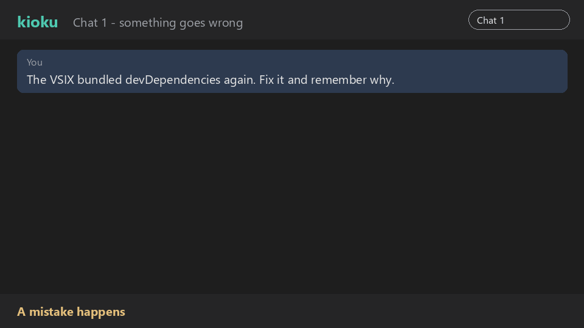

<p align="center">
  
</p>

# kioku

**Stop your AI agent from making the same mistake twice.**

kioku ("memory" in Japanese) gives GitHub Copilot Chat a long-term memory on your own machine. It does not dump chat logs. It records what happened, why the work succeeded or failed, and the lesson to apply next time, and a new chat can search those lessons.

Install one VSIX. Everything runs locally and offline. Searching works in English and Japanese, and no AI credits are used for search or script summaries. It runs on Windows, macOS and Linux.



*Scripted illustration of the kioku tool calls.*

## Try it in 60 seconds

1. Install the extension and start "kioku (local)" in Copilot Chat's MCP list (see Install).
2. Paste this into Copilot Chat:

   ```text
   Save a lesson with kioku save_memory: outcome="failure", cause="Forgot --no-dependencies when packaging a VSIX", lesson="Always pass --no-dependencies to vsce package so devDependencies are not bundled."
   ```

3. Open a new chat and ask: `Check kioku for lessons before I package a VSIX.` The agent finds the lesson saved in the first chat.

To make the agent search and save lessons without being asked, run **kioku: Inject Copilot Instructions** from the Command Palette or the sidebar. The command updates only the marker-delimited kioku block in the project's `.github/copilot-instructions.md` or your global instructions file. The injected block is:

```markdown
## Long-term memory (kioku)
- Before non-trivial debugging, migration or build work, call kioku `search` with `concepts="lesson"` for relevant past lessons.
- After a hard problem is solved or an approach fails, call kioku `save_memory` with `outcome`, `cause` and a reusable `lesson`. Search for duplicates first and skip one-off requests.
- Save corrections and standing instructions from the user as lessons with the project `user-memory`.
- Never store credentials or confidential data.
```

## Why kioku

- **Learn from successes and failures.** The agent saves the outcome, the cause and the lesson. Lessons can be searched on their own, so the same mistake is not repeated and what worked is reused.
- **Share memory across chats and across time.** Memories are stored in one local database instead of inside a single conversation. A new chat can search what earlier chats decided and learned.
- **One file, no setup.** One VSIX bundles the MCP server, the worker and the Bun runtime. Node.js, Bun and Claude Code do not need to be installed.
- **Offline meaning search.** A multilingual embedding model and ONNX Runtime are bundled. Vectors are stored in SQLite and combined with keyword search. No Chroma server, model download or external request is needed.
- **Local-only defaults.** Automatic conversation capture, observation by an external AI, cloud sync, telemetry and automatic updates are turned off.

## What is included

- **Lesson fields.** `save_memory` accepts `outcome`, `cause` and `lesson`, and `search` can select lessons with `concepts="lesson"`. The tool instructions ask the agent to record the cause and the lesson, not only progress or results.
- **A compact MCP surface.** The extension exposes eight tools (`search`, `timeline`, `get_observations`, `save_memory`, `invalidate_memory`, `dumb_search`, `work_state_read`, `work_state_write`) with short instructions to keep the agent's context small.
- **Summaries without AI credits.** A local script makes an extractive summary. Summarizing with GitHub Copilot is an explicit opt-in.
- **A compact sidebar** to browse memories, edit `project`/`cause`/`lesson`, invalidate or restore records, inspect Work State, and install agent instructions without AI-tool calls.

This extension supports Windows x64, macOS (Intel and Apple silicon) and Linux (x64 and arm64), and requires VS Code 1.102 or later. PostgreSQL is not required. Saving and searching work offline, and no model is downloaded at first use.

## Install

1. Install from the Marketplace (`ext install ShunsukeF.kioku-search`). To install a file instead, select "Install from VSIX..." in the Extensions view and choose the VSIX for your platform, for example `kioku-search-win32-x64-0.5.1.vsix`. If an earlier version with the same extension ID exists, it will be updated in place.
2. Reload VS Code if prompted, and open a trusted workspace folder.
3. Open the kioku brain icon on the activity bar. If the worker is not running, the bundled version starts. On first launch, wait for database initialization. A memory count of 0 is normal for a new user.
4. In Copilot Chat's MCP list, start "kioku (local)" and allow access in the VS Code confirmation prompt.

If you already have a manually configured kioku MCP server, disable the manual configuration before using the bundled version. Do not register the same functionality twice. Run **kioku: Copy MCP Configuration** to copy a Cursor or Claude Code compatible `.mcp.json` entry that uses the bundled runtime and the same local database. The extension never deletes or overwrites existing MCP configuration files.

## Language

The sidebar UI is English by default and can be switched to Japanese using the language selector in the sidebar header or the `kioku.language` configuration setting. VS Code dialogs (such as Copilot model selection and send confirmation) remain in English.

## Saving and searching

The agent is instructed to save reusable user corrections and standing instructions, including available user memory notes, as lessons with their source and applicability. User-wide lessons use the `user-memory` project. This relies on the agent's judgment and does not guarantee every instruction will be saved. You can also ask Copilot Chat explicitly: "Save this decision with kioku save_memory". Do not include confidential information or credentials in memories. The chat interaction itself that invokes the MCP tool is subject to your Copilot terms and plan.

When saving successful or failed work, specify the `save_memory` fields `outcome` (`success`, `failure`, or `mixed`), `cause` (reason for success or failure), and `lesson` (what to do or avoid next time, and under what conditions). Memories with a `lesson` can be filtered in `search` by setting `concepts` to `lesson`.

Save one topic per memory. Include the conditions and concrete names needed to apply a lesson. Search with those names or a short question. Semantic candidates are filtered against the score distribution for the query; keyword matches are retained. Empty results do not prove that no relevant memory exists.

Use `invalidate_memory({id, reason, replacedBy})` when a saved observation is outdated or incorrect. It is retained for reference but excluded from search. Set `restore: true` to make it searchable again. This is not deletion of the stored content.

Use the kioku brain icon to search by keywords, project, start date, and end date. Up to 50 results are displayed; selecting a result shows the body and facts. The detail pane edits the project, cause, and lesson, and can invalidate or restore the selected memory. The Work State section reads the active checkout and closes open entries by appending `done` records without deleting history.

The bundled version uses agent-invoked saving and SQLite search. It combines FTS5 keyword ranking with semantic search through reciprocal-rank fusion, and computes similarity inside the worker. A multilingual embedding model (including Japanese support) runs locally on your PC without sending search queries or memories to external servers. Stored vectors include a 1-bit signature for large-candidate prefiltering. The worker builds missing vectors in the background at startup and after saves; edited content is reindexed when next needed. Initial search indexing time depends on the number of memories.

Automatic conversation harvesting, observation by external AI, Chroma, cloud synchronization, telemetry, and automatic updates are disabled at startup. This extension does not automatically record complete chat transcripts. Authentication and code analysis designed for shared servers are not used. The header displays the extension version; the internal worker version can be checked in the connection tooltip.

Run **kioku: Export Project Lessons** to write active `lesson` memories for one project as JSONL or Markdown. Run **kioku: Import Project Lessons** to load either format. Imports carry a source fingerprint, so importing the same file again skips existing records. Export excludes invalidated memories.

## Summaries

Copilot summaries are off by default. When off, clicking "Summarize with script" creates an extractive summary locally on your PC from the original text. It displays the title, subtitle, up to 6 facts, and the beginning of the body, indicating if content was omitted. This operation involves no external network transmission and consumes no AI credits.

When on, clicking "Summarize with Copilot" after selecting a memory proceeds to an explicit confirmation prompt and model selection. Only the title, subtitle, body, and facts of the selected memory are sent. Switching the setting on sends nothing. The summary result is displayed temporarily and does not modify the original memory.

Copilot sign-in, available models, usage quotas, and organization policies follow your environment. If no model is available, an error is shown without falling back to another service. Switching Copilot off cancels an in-progress summary, but already transmitted data cannot be recalled. The statement that script summaries consume no credits applies strictly to local script summaries within this extension.

## Data and existing environment

The default storage directory is `.claude-mem` in your home directory (`%USERPROFILE%\.claude-mem` on Windows, `~/.claude-mem` on macOS and Linux). Existing `CLAUDE_MEM_DATA_DIR` environment variables or paths defined in existing configuration files are respected. If an existing database is found, it is reused; if none exists, an empty database is created on first startup. The distribution package contains no user databases, memories, or credentials. Updating, reinstalling, or uninstalling the extension does not delete personal data. Memories are not automatically transferred to other PCs.

The worker only communicates over loopback addresses on the local machine. The port is determined from existing settings and worker port calculation logic. If necessary, specify a loopback HTTP URL in the VS Code setting `kioku.workerUrl`. Non-loopback URLs, credentials embedded in URLs, and redirects are rejected.

If a worker of the same version supporting local semantic search is already running, it is reused. Configuration files specific to that worker are not modified by this extension. A shared worker is not terminated when VS Code exits.

If a worker with a mismatched version or a different service responds, it is not stopped or replaced; instead, an error is reported. Stop the older worker after identifying its caller, then retry. Back up your existing database before opening it with a new version for the first time. The worker performs any necessary database migrations automatically. If startup fails, check the `logs` folder in the data directory.

## Build

Build on the operating system and CPU architecture you are packaging for: the bundled Bun runtime and ONNX Runtime binaries are native, so a VSIX is built on its own platform (Windows x64, macOS x64 or arm64, Linux x64 or arm64). The `Package VSIX` GitHub Actions workflow builds all targets. Prepare the worker dependencies, extension devDependencies, and Google Chrome. Building requires Node.js 24 or later and Bun. These are not needed after distributing the package to users. Network access is used only during the build to fetch pinned model files and licenses. Model and tokenizer files are verified by size and SHA-256 hash. Runtime model loading is restricted strictly to local files.

```powershell
npm run typecheck:root
npm run build
npm --prefix vscode-extension ci --ignore-scripts
npm --prefix vscode-extension run build
npm --prefix vscode-extension run check
npm --prefix vscode-extension test
node vscode-extension/test/integrated-smoke.mjs
```

Run `vsce package --target <target> --no-dependencies --allow-missing-repository` in the extension folder, where `<target>` is `win32-x64`, `darwin-x64`, `darwin-arm64`, `linux-x64` or `linux-arm64`. Then run `node test/package-content.mjs <vsix>`. SHA-256 hashes of bundled runtime files are listed in `runtime/integrity.json`; licenses and notices are included in `runtime/licenses` and `runtime/THIRD-PARTY-NOTICES.txt`. The license for the Lucide toolbar icons is in `media/lucide-license.txt`.

For a host-native single executable, run `npm run build:cli-binary` from the repository root and keep its generated `dist/binaries/package.json`, lock file, and `node_modules` beside the executable. That package installs the native `sqlite-vec` platform extension and the optional media sidecar. The VSIX keeps the executable separate because adding both the compiled worker and bundled Bun runtime would exceed the Marketplace package limit.

The staged Rust MCP core is available with `npm run build:rust-mcp`. Set `KIOKU_RUST_MCP_EXE` to the generated `rust/target/release/kioku-core.exe` (or the host-specific executable on macOS/Linux) before starting VS Code. The Rust process serves `search`, `timeline`, and `get_observations` directly from the existing `claude-mem.db`; write and work-state calls are delegated to the existing local kioku worker. The switch is opt-in and leaves the bundled Bun MCP path unchanged by default.

## Acknowledgments and license

Developed from [claude-mem](https://github.com/thedotmack/claude-mem). Distributed under Apache-2.0; original copyright and attribution notices are retained in LICENSE and NOTICE. kioku is not affiliated with the Claude-Mem project or cmem.ai.